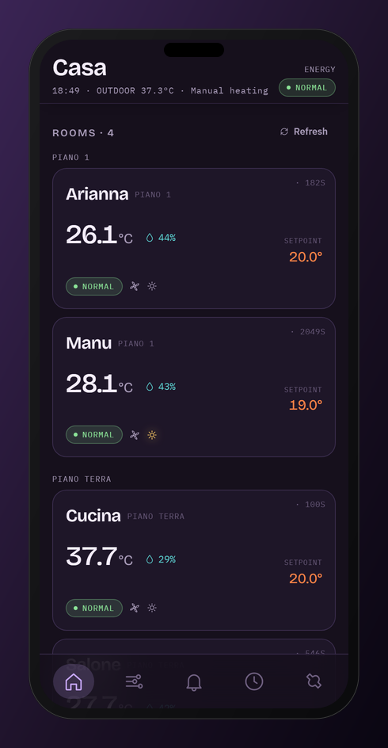
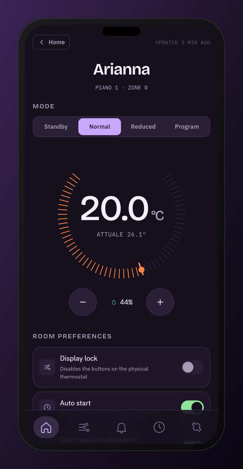
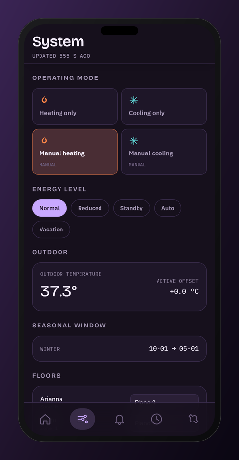
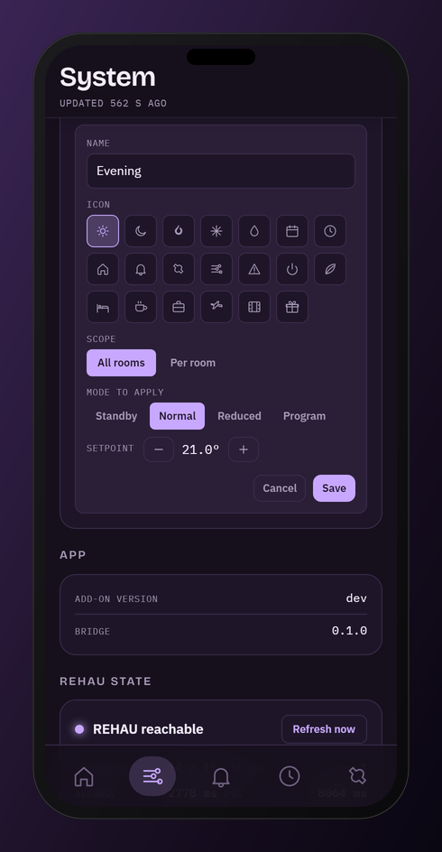
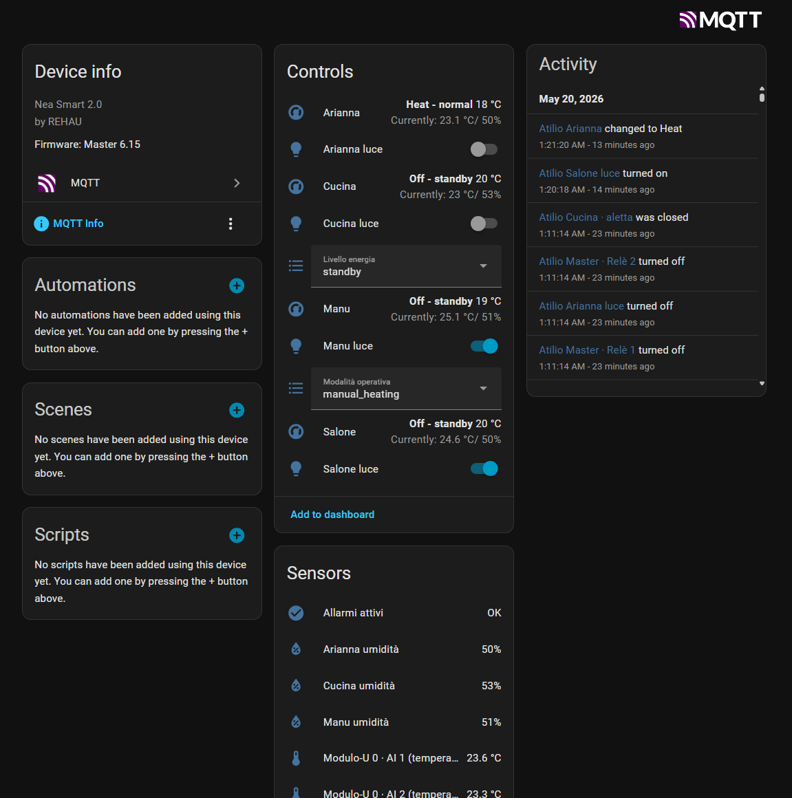

# REHAU Nea Smart 2.0 — local control & Home Assistant

**Control your REHAU Nea Smart 2.0 heating and cooling locally, without
REHAU's cloud.** Rooms, setpoints, programs, scenes and alarms, in a clean web
app on your phone and as ready-made entities in Home Assistant.

No REHAU account, no e-mail codes, nothing leaving your home.

  
  
  
  

---

## Two ways to use it

The REHAU base station only shows its local web interface over its own
Wi-Fi (AP mode). Something has to sit on that Wi-Fi and bring it to your
network: pick one of these two.

| | 🔌 **BetteRehau bridge** (recommended) | 🏠 **Home Assistant add-on** |
| --- | --- | --- |
| What it is | Firmware for a small **Olimex ESP32-POE** board | An add-on that runs inside Home Assistant |
| Needs Home Assistant? | No (works great with it, through MQTT) | Yes, HA OS or Supervised |
| How it reaches REHAU | The board joins REHAU's Wi-Fi and plugs into your LAN with Ethernet | The HA host joins REHAU's Wi-Fi (e.g. with a USB Wi-Fi dongle) |
| Web app | Served by the board itself | In the HA sidebar, or on port 8080 |
| Get started | [FIRMWARE.md](FIRMWARE.md) · [download](https://github.com/manuxio/rehau-nea-smart-2-home-assistant/releases/latest) | [INSTALL.md](INSTALL.md) · [quick start](#home-assistant-add-on-quick-start) |

Both give you the same web app and the same kind of Home Assistant entities.

## What you get

- 🌡️ **Every room**: temperature, humidity, setpoint, mode (normal, reduced,
  program, standby, party), lock, auto-start, open-window detection, light.
- 🗓️ **Programs**: edit the daily and weekly programs and assign them to rooms.
- ✨ **Scenes**: one tap to set a mode and temperature in all rooms, or per room.
- 🏠 **Home Assistant**: a device with a climate entity per room plus sensors
  and switches, created automatically. No YAML.
- 📱 **A real app feel**: install it on your phone's home screen. Dark and
  light theme, English and Italian.
- 🛠️ **Installer tools**: heat curve, calibration, bus, live I/O, diagnostics
  and every installer setting, for whoever has the installer code.

  

---

## Home Assistant add-on: quick start

> First time? [INSTALL.md](INSTALL.md) walks you through every step,
> including putting the base station in AP mode and connecting HA to it.

1. **Add this repository** to Home Assistant:

   

   or go to *Settings → Add-ons → Add-on Store → ⋮ → Repositories* and paste
   `https://github.com/manuxio/rehau-nea-smart-2-home-assistant`.
2. **Install** *REHAU Nea Smart 2 Bridge (local)*. You'll also need the
   **Mosquitto broker** add-on.
3. **Configure** at least `device_url` (the base station's address) and
   `device_installer_code` (the 8-character installer code).
4. **Start** it. After about a minute your rooms appear in Home Assistant, and
   **REHAU** shows up in the sidebar.

All options, the MQTT topics and the API are described in the
[add-on reference](docs/REFERENCE.md). The add-on runs on `amd64` and
`aarch64`.

## Security in short

- Everything stays on your network: the bridge talks to the base station
  directly over your LAN.
- Opened from the Home Assistant sidebar, the web app logs you in
  automatically. That only works for requests that really come through Home
  Assistant ([details](docs/REFERENCE.md#authentication--ha-ingress)).
- On port 8080 you log in with a password. **Change the default `admin123`**
  before letting anyone else reach that port.

Found a security problem? Please report it privately through
[GitHub security advisories](https://github.com/manuxio/rehau-nea-smart-2-home-assistant/security/advisories/new)
instead of a public issue.

---

## Help & contributing

- 🐛 Something not working? [Open an issue](https://github.com/manuxio/rehau-nea-smart-2-home-assistant/issues),
  and say whether you use the board or the add-on, with its version.
- 💬 Pull requests are welcome. The add-on is built from this repository:
  `apps/bridge` (Node.js bridge), `apps/web` (React web app) and
  `packages/types`; `rehau-bridge/` holds the packaged add-on.
- 📜 What changed in each version: [CHANGELOG.md](CHANGELOG.md).

## License

MIT.

REHAU® and Nea Smart® are trademarks of REHAU AG. This is an independent
project, not affiliated with or endorsed by REHAU.
